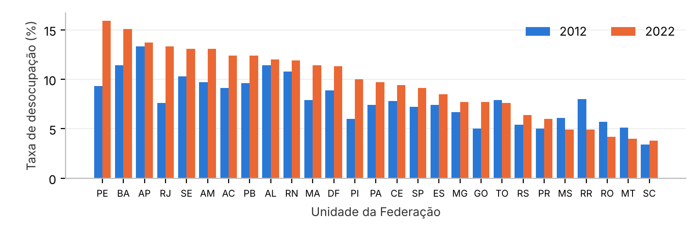
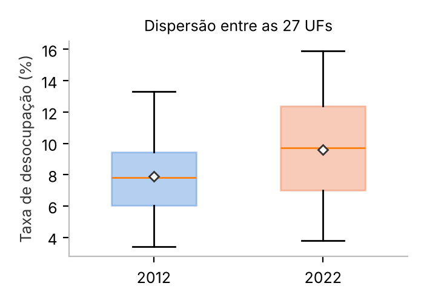
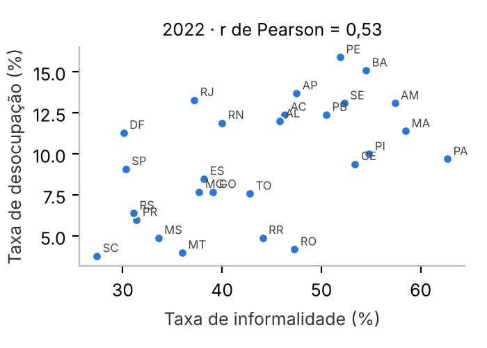

# Lupa Dados — Números que Falam: Descobrindo o Brasil

*Relatório-síntese do grupo · Projeto Integrador Python & Matemática · Tema 6: Trabalho e Emprego · Personas: Ministério do Trabalho, Sebrae e Indústria*

| Integrante | Parte | Indicador |
|---|---|---|
| Arthur de Souza, Clara Lima e Gustavo Henrique | Grupo | Tema 6 — Taxa de desocupação (2012 × 2022) e informalidade (PNAD Contínua) |
| Arthur de Souza | Individual | 1 — População por grupo de idade, sexo e raça (Censo 2022) |
| Clara Lima | Individual | 2 — Alfabetização por sexo e raça (Censo 2022) |
| Gustavo Henrique | Individual | 4 — Mulheres (Censo 2022, Projeções e Estatísticas de Gênero) |

## 1. Problema e método

A Ministra do Trabalho, o Sebrae e a Indústria querem saber **onde o desemprego piorou entre 2012 e 2022**, se os estados ficaram mais desiguais, **onde está a informalidade** e o que aconteceu com o emprego industrial e com o trabalho por conta própria. Usamos as médias anuais da PNAD Contínua para as 27 UFs, tratadas em Python (Pandas): leitura das tabelas do IBGE, conversão de números no padrão brasileiro, tratamento de símbolos (“-”, “...”), padronização das UFs e transformação para formato longo. As estatísticas (média, mediana, moda, quartis, IQR, amplitude, variância, desvio padrão, CV e outliers pela regra de 1,5×IQR) foram implementadas com as fórmulas de aula e conferidas contra o NumPy.

## 2. Principais resultados

  
    
| Desocupação nas 27 UFs | 2012 | 2022 |
|---|---|---|
| Brasil (taxa nacional) | 7,4% | 9,6% |
| Média / mediana das UFs | 7,90 / 7,8 | 9,61 / 9,7 |
| Q1 – Q3 | 6,05 – 9,45 | 7,0 – 12,4 |
| IQR (p.p.) | 3,4 | 5,4 |
| Amplitude (p.p.) | 9,9 | 12,1 |
| Desvio padrão (p.p.) | 2,31 | 3,51 |
| Coef. de variação | 29,2% | 36,5% |

    
**O desemprego subiu e ficou mais desigual:** 22 das 27 UFs pioraram e todas as medidas de dispersão cresceram. Maiores altas: PE (+6,6 p.p.), RJ (+5,7) e PI (+4,0). Melhoraram RR, RO, MS, MT e TO.

  
  

> **Outliers:** entre as 27 UFs não há outliers (em 2022, limites de −1,1% a 20,5%), por isso média e mediana quase coincidem. Dentro das regiões, porém, **Pernambuco (15,9%)** destoa do Nordeste e o **Rio de Janeiro (13,3%)** destoa do Sudeste: com o RJ, a média do Sudeste é 9,65%; sem ele, 8,43% — a mediana (8,8%) é a melhor referência para a região.

  
    
## 3. Informalidade e estrutura do emprego

    
Em 2022, a informalidade foi de 39,4% no Brasil, mas varia de 27,4% (SC) a 62,7% (PA) entre as UFs (mediana 44,1%, IQR 15,5 p.p., desvio padrão 9,76 p.p.). As maiores taxas estão no Norte e no Nordeste: PA, MA, AM, PI e BA. A correlação com a desocupação é **r = 0,53** (positiva e moderada).

    
      - **Indústria geral:** 13,3 mi de ocupados (2012) → 12,6 mi (2022), −4,9%, ainda abaixo de 2012.

      - **Conta própria com CNPJ:** 4,2 mi (2016) → 6,6 mi (2022), +55,5%; mas 19,0 mi seguem sem CNPJ.

      - **Desigualdade:** desocupação de 14,0% entre mulheres pretas ou pardas × 6,3% entre homens brancos.

    
  
  

## 4. O que os indicadores individuais acrescentam

  - **População (Arthur):** idade mediana de 35,2 anos (dados agrupados; IBGE: 35) e média de 36,4 — assimetria à direita pela cauda de idosos. 69,3% estão em idade ativa; o Norte é o mais jovem (mediana 29,3). Outliers entre UFs: SP e MG (população), DF e RJ (densidade) e RR (crescimento de 41%) — a média é muito maior que a mediana.

  - **Alfabetização (Clara):** 93,0% (11,4 mi de analfabetos). Analfabetismo entre UFs: média 8,81% > mediana 6,90%; o Nordeste tem mediana 4,5 vezes a do Sul. Indígenas 16,1% × brancos 4,3%; outliers nos recortes de idosos pretos, pardos e indígenas. DF é outlier (para baixo) no Centro-Oeste.

  - **Mulheres (Gustavo):** 51,5% da população; maioria a partir dos 25–29 anos; outliers da razão de sexo nas idosas do Sul e Sudeste (70+). Participam menos do mercado (53,3% × 73,2%) e recebem 78,9% do rendimento dos homens, apesar de mais escolarizadas.

## 5. Recomendações

| Persona | Recomendação baseada nos dados |
|---|---|
| Ministério do Trabalho | Metas regionais (a dispersão entre UFs cresceu); prioridade a PE, BA, RJ e Nordeste;
  programas com recorte de gênero e raça; creches para ampliar a participação feminina; alfabetização de adultos ligada à
  qualificação. |
| Sebrae | Formalização (MEI, crédito orientado, compras públicas) em PA, MA, AM, PI e BA, onde a
  informalidade passa de 54%; empreendedorismo feminino nas áreas urbanas. |
| Indústria | O emprego industrial não voltou ao nível de 2012: há mão de obra disponível nos estados com mais
  desocupação. Qualificação (com etapas de letramento para 45+) e metas de mulheres em cargos técnicos e de liderança. |

## 6. Produto entregue

Painel unificado em Streamlit (`app.py`) com menu de navegação, upload de CSV/XLSX, filtros por ano, região, UF, sexo, cor ou raça e faixa etária, KPIs, barras comparativas, boxplots, histogramas, mapas por UF, abas de respostas às perguntas de negócio e seção de notícias com imagens. Dashboards individuais em `individuais/`.

Fontes: IBGE — PNAD Contínua, Retrospectivas 2012-2024 (fev/2025) e 2012-2022; Censo Demográfico 2022; Anuário Estatístico do Brasil 2024; Estatísticas de Gênero, 3ª ed. (2024). A série de desocupação por UF foi reponderada pelo IBGE em 2024 (Brasil 2022 = 9,6%; na publicação original, 9,3%).
